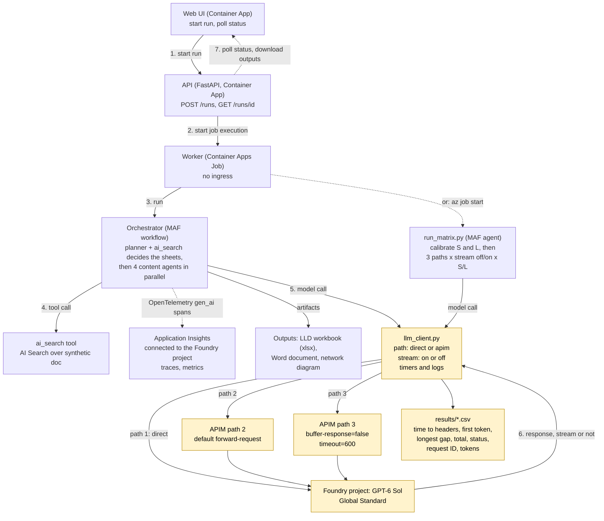

# apim-timeout-lab

> Not an official Microsoft sample. Lab code, **synthetic data only**.

## Problem

A workload makes **long LLM calls (4-7 min)** from an Azure Container Apps Job to GPT-6 Sol on Microsoft Foundry,
directly or through Azure API Management (APIM). Some calls fail and it is unclear **which hop cuts them, or why**.
This lab measures it with the real model, per call: time to headers, time to first token, longest silent gap,
total time, HTTP status, request ID and tokens.

## What we test

Three paths x streaming off/on x two calibrated prompts, **S** (~300 s) and **L** (~450 s). The Job has no ingress, so only the outbound path is tested.

| Path | Route |
|---|---|
| 1. `direct` | Job → Foundry |
| 2. `apim-default` | Job → APIM (default `forward-request`) → Foundry |
| 3. `apim-stream` | Job → APIM (`<forward-request timeout="600" buffer-response="false" />`) → Foundry |

| | Hypothesis (verify, don't assume) |
|---|---|
| H1 | APIM cuts calls silent for ~230-240 s (`forward-request` waits for response headers). |
| H2 | Streaming plus `buffer-response="false"` avoids that. |
| H3 | Even when streaming, a 4+ min silent gap before the first token can be dropped by the load balancer inside APIM. |
| H4 | The Job's outbound path is not the limiting hop. |

Every Azure claim is labelled **expected** (documented, Learn link) or **observed** (our run).

## Architecture



Yellow = under test. APIM calls Foundry with its managed identity; paths 2 and 3 differ only in the `forward-request` policy ([apim/](apim)).

```
web/ api/ worker/   UI, API, and the Job: a Microsoft Agent Framework (MAF) workflow and the matrix, both on MAF agents;
                    llm_client.py times every HTTP call underneath
infra/ apim/        Bicep (Foundry project, App Insights, APIM, Container Apps) and the two APIM policies
data/ results/      synthetic HLD generator and search-index uploader; CSVs
```

## The app: same flow as the customer's

Synthetic, generated at build, but shaped like the real thing: the planner's envelope is `engagement_id` + `scope_inventory` +
about 200 `facts[]` chunks (~100K tokens; each `{content, filename, page_number, section_path, chunk_type: prose|table|iac}`).

1. **Planner** (one agent, one tool `ai_search(query, domain?, top?)`, high reasoning) gets that starting slice, searches the whole HLD for what is
   missing (segment table, cluster roles, subscriptions), and **derives the list of sheets** with an owner agent each. Not a fixed list.
2. **Content agents** (cover, network, addressing, compute; in parallel) fill only the sheets assigned to them, each with its own `ai_search`.
3. **Outputs:** `lld-workbook.xlsx`, `design-document.docx`, `network-diagram.mmd`, downloadable in the UI.

The web UI starts a run, the API starts the worker Job, the UI polls. Streaming on/off, path, reasoning effort, payload size and rounds
(to stretch a run to 20-30 minutes) are chosen per run.

## Foundry project, monitoring and traces

- **Project:** `lab` on the Foundry resource; the GPT-6 Sol deployment lives on that resource and is available in the project (Infra: [main.bicep](infra/main.bicep)).
- **Traces:** the worker exports OpenTelemetry gen-ai spans (workflow, executor, `invoke_agent`, `chat`, `execute_tool ai_search`) to the Application Insights
  resource connected to the project, so they show under **Agents → Traces** in the Foundry portal. Each `chat` span also carries our measured
  `lab.ttfh_s`, `lab.ttft_s`, `lab.longest_gap_s`, `lab.total_s` and request IDs. Prompt content is not recorded.
  Query them in Log Analytics: `AppDependencies | where Name startswith "chat"`. Reading them needs *Log Analytics Reader* on the workspace.
  Agent IDs are stable (`lab-planner`, `lab-cover`, ...).
- **Observed:** Azure Monitor's default sampler (about 5 traces per second) silently dropped most spans of a bursty agent run; the lab sets `sampling_ratio=1.0`.
- **Register the agents later:** expected requirements ([Learn: register a custom agent](https://learn.microsoft.com/azure/foundry/control-plane/register-custom-agent)):
  a Foundry project with an **AI gateway** (Foundry uses APIM to register agents as APIs), Application Insights connected to the project (done), an agent
  reachable on an HTTP or A2A endpoint, and OpenTelemetry gen-ai traces with an agent ID (done). **Caveat:** an existing APIM can be used for the AI gateway only in a
  **v2 tier** ([Learn: AI Gateway](https://learn.microsoft.com/azure/foundry/configuration/enable-ai-api-management-gateway-portal)), and this lab's APIM is
  *Developer* (classic), so it does not qualify. Also, the customer's APIM tier may change the idle-timeout results, so confirm it before reading them.
  The worker is a Job without an endpoint; registration will need the orchestrator exposed as an HTTP agent.

## Results

**Observed (our runs, real GPT-6 Sol, Sweden Central, APIM Developer; data in [results/runs.csv](results/runs.csv)).** 1 run per cell (2 for the L reruns).

| # | Path | Stream | Expected | Observed S (~180-270 s) | Observed L (~210-285 s) |
|---|---|---|---|---|---|
| 1 | direct | off | May be dropped when silent ≥ 4 min | ok, 188 s | **cut twice at 240.7 s and 241.4 s** (`ReadError`, no HTTP status); ok at 102 s in an earlier shorter run |
| 2 | direct | on | Passes while tokens flow | ok, 268 s | ok, 230 / 284 / 270 s |
| 3 | apim-default | off | Cut near 230-240 s (H1) | ok, 190 s | **HTTP 500 at 230.1 s** once (APIM log: `BackendConnectionFailure`, "Underlying transport connection was unexpectedly closed"); then ok at 229 s and 221 s |
| 4 | apim-default | on | Buffered by default; may be cut or delayed | ok, 220 s | ok, 240 / 222 s |
| 5 | apim-stream | off | Silent > 4 min: likely cut | ok, 177 s | ok, 229 / 224 s |
| 6 | apim-stream | on | Passes while tokens flow (H2) | ok, 238 s | ok, 211 / 226 s |

**What this does and does not show**
- **Observed:** a non-streaming call that stays silent past ~240 s was cut on the direct path (2 of 2), and one APIM-default call was cut at 230.1 s. This supports H1 and says H4 is not safe to assume.
  The direct cut happens at the same ~4-minute mark as Learn's idle timeout (see the links below), but the cut point alone does not tell us which hop closed the connection.
- **Observed:** streaming calls that kept producing tokens survived up to 284 s on the direct path.
- **Not shown:** every non-streaming call that finished below ~230 s passed on every path, so most cells sit just under the limit and prove little. No APIM call exceeded ~240 s, so
  **H2 (streaming + `buffer-response=false`) and H3 (4+ min silent before the first token) are not tested at APIM**. Before the first token the model was silent for only 35-76 s at its longest in these runs.
- **Why the calls are short:** GPT-6 Sol stops writing at about 35-40K output tokens (~230-290 s) whatever the prompt asks for, and a larger input makes it answer shorter. We could not reach the 450 s target
  with output length alone; L adds silent reasoning (`xhigh`), which moved the first token to ~40-75 s. A call that is silent for 4+ minutes before its first token needs a harder reasoning task and is the next thing to try.
- The pipeline's 8-minute demo run is many calls of 3-120 s each; it is not evidence about long single calls.

Expected, from Learn: `forward-request` `timeout` is the wait for response **headers** and values above 240 s may not be honoured;
`buffer-response="false"` relays chunks immediately ([forward-request](https://learn.microsoft.com/azure/api-management/forward-request-policy)).
Connections idle 4 minutes or more need a keep-alive because of the Azure Load Balancer's 4-minute idle timeout ([SSE guidance](https://learn.microsoft.com/azure/api-management/how-to-server-sent-events)).
Outbound flows default to a 4-minute idle timeout and are dropped silently unless TCP reset is enabled ([outbound rules](https://learn.microsoft.com/azure/load-balancer/outbound-rules#outbound-flow-idle-timeout-and-tcp-reset)); whether that applies to Job egress is H4.

**How to read it**
- Path 2 cuts at ~230-240 s and path 3 passes: configuration was the problem. (Not yet shown: our one APIM-default cut was not repeated, and path 3 had no call above ~240 s.)
- Path 3 streaming still cuts after a long silent stretch: the 4-minute idle limit applies. Options: async (202 + polling), lower reasoning effort, or bypass the gateway for those calls.
- Everything passes: the difference lies elsewhere (prompt size, retries, concurrency).

CSV columns: `ttfh_s` (headers), `ttfb_s` (first byte), `ttft_s` (first token), `longest_gap_s`, `tail_silence_s` (silence before the end or cut),
`total_s`, `http_status`, `outcome` (`completed`, `truncated`, `http_error`, `error`), request IDs, tokens.

## Run it

Needs Azure CLI, Python 3.13, Node 22. Copy `.env.example` to `.env`.

```bash
python3.13 -m venv .venv && .venv/bin/pip install -e ".[dev]"
.venv/bin/python -m pytest -q          # offline unit tests, no Azure

set -a; source .env; set +a            # deploy: billable, APIM is the main cost; get an estimate first
az group create -n "rg-$NAME_PREFIX" -l "$AZURE_LOCATION"
az deployment group create -g "rg-$NAME_PREFIX" -p infra/main.bicepparam                   # phase 1
for i in worker api web; do az acr build -r <acr> -t $i:v1 -f $i/Dockerfile .; done        # <acr> = output acrName
DEPLOY_APPS=true IMAGE_TAG=v1 az deployment group create -g "rg-$NAME_PREFIX" -p infra/main.bicepparam
python data/upload_index.py --search-name <search> --resource-group "rg-$NAME_PREFIX"      # seed AI Search
```

**Demo:** open the `webUrl` output (any user, password `LAB_PASSWORD`), pick a path and streaming, start a run, watch per-call timings.

**Matrix (costs money):** without `confirm-spend` it only prints the plan and worst-case tokens.

```bash
infra/run-matrix.sh v1 max-output-tokens=120000                 # dry run
infra/run-matrix.sh v1 max-output-tokens=120000 confirm-spend   # calibrate S and L on path 1, then 12 cells
```

Calibration stops and reports if S or L can't reach its target. Results land in Log Analytics (`CALL {json}` console lines, APIM gateway logs);
turn logs into a CSV with `python -m worker.results results/runs.csv < logs.txt`.

## Notes

- GPT-6 Sol rejects function tools with `reasoning_effort` on `/chat/completions` (observed, HTTP 400), so the lab uses the Responses API.
- Path 2's policy only swaps the caller's key for APIM's managed-identity token (Foundry key auth is off); it has no `forward-request` element.
- Pipeline retries (`LLM_MAX_ATTEMPTS`, `LLM_RETRY_BACKOFF_S`) are placeholders until the customer's real settings are known; the matrix never retries.
- **Observed:** with a 150K tokens/min quota, a ~100K-token planner (every tool-call turn is billed for the whole conversation) hits `exceeded token rate limit`, and the error arrives **inside the stream after HTTP 200**, so an HTTP-level retry cannot see it. The pipeline therefore paces requests to `LLM_TPM_BUDGET` (counting the whole conversation for continuation turns) and retries whole agents; the matrix does neither and spaces its calls (`--cooldown-s`) so a rate limit can never pass for a cut (it is labelled `RateLimit`).
- **Observed:** a customer-sized demo run (~110K-token planner, high reasoning, streaming, APIM path 3, 150K TPM quota) completed in about 8 minutes: 18 model calls, ~954K prompt tokens, 0 failures, with the workbook, document and diagram produced. Capacity is the limit here; a customer-sized run needs far more than 150K TPM to go faster.
- The UI sits behind basic auth; don't expose it with real data. Cleanup: `az group delete -n "rg-$NAME_PREFIX"`.

MIT licensed.
