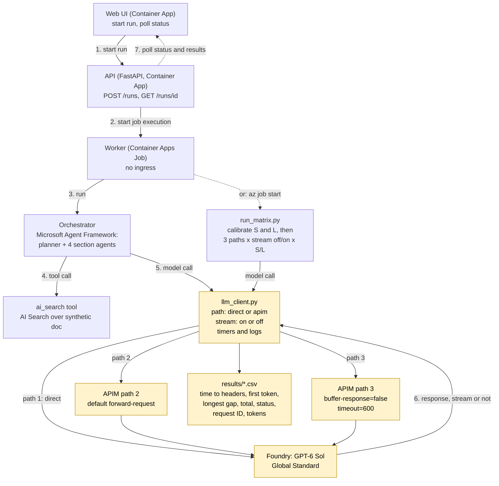

# apim-timeout-lab

> Not an official Microsoft sample. Lab code with **synthetic data only**; use at your own risk.

## The problem

A workload makes **long LLM calls (4-7 minutes)** from an Azure Container Apps Job to a GPT-6 Sol deployment on
Microsoft Foundry, either directly or through Azure API Management (APIM). Some of these calls fail, and it is
not clear **which hop cuts them or why**.

This lab reproduces that situation with a real model and measures, per call: time to response headers, time
to first token, longest silent gap between chunks, total time, HTTP status, request ID and token usage.

## What we test

Three paths, each with streaming off and on, with two calibrated prompts: **S** (about 300 s) and **L** (about 450 s).

| Path | Route |
|---|---|
| 1. `direct` | ACA Job → Foundry |
| 2. `apim-default` | ACA Job → APIM, default `forward-request` → Foundry |
| 3. `apim-stream` | ACA Job → APIM, `<forward-request timeout="600" buffer-response="false" />` → Foundry |

The Job has no ingress, so only the **outbound** path is tested.

| | Hypothesis (to verify, not assume) |
|---|---|
| H1 | APIM cuts calls that are silent for ~230-240 s (`forward-request` waits for response headers). |
| H2 | Streaming plus `buffer-response="false"` avoids that. |
| H3 | Even when streaming, a 4+ minute silent gap before the first token can be dropped by the load balancer inside APIM. |
| H4 | The ACA Job's outbound path is not the limiting hop. |

Every Azure claim below is labelled **expected** (documented, with a Learn link) or **observed** (our own run).

## Architecture



Yellow = what is under test. APIM authenticates to Foundry with its managed identity; paths 2 and 3 differ only
in the `forward-request` policy ([apim/](apim)). The agents run on Microsoft Agent Framework; the model client
under them times every HTTP call, so the same telemetry covers the demo pipeline and the matrix.

## Repo layout

```
web/      Next.js UI: start a run, poll status
api/      FastAPI: POST /runs, GET /runs/{id}; starts the worker Job
worker/   llm_client.py (timed model client), orchestrator.py + agents.py (Agent Framework),
          search_tool.py, run_matrix.py, prompts.py (S and L), tests/
data/     synthetic design-document generator + AI Search index uploader (output is generated, not committed)
apim/     policy-default.xml, policy-stream.xml
infra/    main.bicep (+ apim.bicep, apps.bicep), run-matrix.sh
results/  CSVs (see "Results files" below)
```

## Results so far

**Real GPT-6 Sol matrix: not run yet.** It is gated by the cost guard below. What exists:

- *Observed (our run, GPT-6 Sol, tiny capped smoke runs):* the agent pipeline (planner, 4 section agents, `ai_search`
  tool calls) completes on paths 1 and 3 with streaming, about 35-40 s end to end
  ([results/smoke.csv](results/smoke.csv)). These runs are far too short to say anything about timeouts.
- *Observed (our run, **mock backend**, since removed):* an earlier harness (git commit `00e7732`) sent calls from the
  same ACA Job to a fake backend that stayed silent on purpose. It only shows that the hops *can* cut idle connections;
  it says nothing about GPT-6 Sol.

| Mock-backend probe | Observed |
|---|---|
| Direct, silent 300 s and 450 s | **No response ever reached the client** (read timeout at 900 s), although the backend finished at 300 s / 450 s. H4 not supported for silent calls. |
| APIM default, silent 300 s | **HTTP 500 after 230 s** ("Internal server error"). Consistent with H1. |
| APIM + `buffer-response=false`, stream 450 s, chunk every 10 s | Completed, 450 s, 3 parallel streams too. Consistent with H2. |
| APIM + buffering on, same stream | Completed too; chunks were not coalesced (tiny chunks). |
| APIM stream, 10 s of chunks then **300 s silence** | **Connection cut at 240 s** (230 s after the last chunk), `incomplete chunked read`. Consistent with H3. |

Expected (documented):
- `forward-request` `timeout` is the wait for response **headers**; values above 240 s may not be honoured; `buffer-response="false"` relays chunks immediately ([forward-request policy](https://learn.microsoft.com/azure/api-management/forward-request-policy)).
- Connections idle for 4 minutes or more need a keep-alive, because the Azure Load Balancer used by APIM enforces a 4-minute idle timeout ([Configure API for SSE](https://learn.microsoft.com/azure/api-management/how-to-server-sent-events)).
- Azure outbound flows default to a 4-minute idle timeout and are dropped silently unless TCP reset is enabled ([outbound rules](https://learn.microsoft.com/azure/load-balancer/outbound-rules#outbound-flow-idle-timeout-and-tcp-reset), [TCP reset](https://learn.microsoft.com/azure/load-balancer/load-balancer-tcp-reset)). Whether this applies to ACA Job egress is what H4 tests.

## Run matrix and results table

Fill the **Observed** columns from `results/runs.csv` after a run. S ≈ 300 s, L ≈ 450 s, both longer than 240 s.

| # | Path | Stream | Expected | Observed S | Observed L |
|---|---|---|---|---|---|
| 1 | direct | off | May be dropped when silent ≥ 4 min (outbound idle timeout) | _not run_ | _not run_ |
| 2 | direct | on | Passes while tokens flow; a long silent start may be dropped | _not run_ | _not run_ |
| 3 | apim-default | off | Cut near 230-240 s (H1) | _not run_ | _not run_ |
| 4 | apim-default | on | Buffered by default; likely cut or delayed | _not run_ | _not run_ |
| 5 | apim-stream | off | Still silent > 4 min: likely cut | _not run_ | _not run_ |
| 6 | apim-stream | on | Passes while tokens flow (H2); a ≥ 4 min silent stretch before the first token may be cut (H3) | _not run_ | _not run_ |

Per call, the CSV has: `ttfh_s` (time to response headers), `ttfb_s` (first body byte), `ttft_s` (first token),
`longest_gap_s`, `tail_silence_s` (silence before the end or the cut), `total_s`, `http_status`, `outcome`
(`completed`, `truncated`, `http_error`, `error`), request IDs and token usage.

## How to read the results

- Path 2 cuts at ~230-240 s and path 3 passes: **configuration was the problem** (use the path 3 policy).
- Path 3 with streaming still cuts after a long silent stretch: **the 4-minute idle limit applies**. Options: async (202 + polling),
  lower reasoning effort, or bypass the gateway for those calls.
- Everything passes: the difference lies elsewhere (for example prompt size, retries, or concurrency).

## Run it

Prerequisites: Azure CLI, Python 3.13, Node 22. Copy `.env.example` to `.env` and fill it in.

```bash
# offline tests (fake model, no Azure)
python3.13 -m venv .venv && .venv/bin/pip install -e ".[dev]"
.venv/bin/python -m pytest -q && .venv/bin/ruff check .

# synthetic data is generated (git-ignored): the worker image builds it, tests build a small copy.
# To inspect it locally: python data/generate_synthetic_docs.py --pages 180
```

**Deploy** (creates billable resources: APIM Developer is the main cost driver; get a cost estimate first):

```bash
set -a; source .env; set +a
az group create -n "rg-$NAME_PREFIX" -l "$AZURE_LOCATION"
az deployment group what-if -g "rg-$NAME_PREFIX" -p infra/main.bicepparam                 # review
az deployment group create  -g "rg-$NAME_PREFIX" -p infra/main.bicepparam                 # phase 1
for i in worker api web; do az acr build -r <acr> -t $i:v1 -f $i/Dockerfile .; done      # <acr> = deployment output acrName
DEPLOY_APPS=true IMAGE_TAG=v1 az deployment group create -g "rg-$NAME_PREFIX" -p infra/main.bicepparam
python data/upload_index.py --search-name <search> --resource-group "rg-$NAME_PREFIX"    # seed AI Search
```

**Demo:** open the `webUrl` deployment output (user any, password `LAB_PASSWORD`), choose a path and streaming, start a run, and
watch per-call timings. `reasoning=low` with a small payload costs cents; the defaults (high reasoning, ~100K-token planner
input) cost more.

**Matrix (real model, costs money):** a cost guard is built in. Without `confirm-spend` it only prints the plan.

```bash
infra/run-matrix.sh v1 max-output-tokens=120000                 # dry run: plan and worst-case token budget
infra/run-matrix.sh v1 max-output-tokens=120000 confirm-spend   # step 0: calibrate S and L on path 1, then 12 cells
```

Step 0 stops and reports if S (≈300 s) or L (≈450 s) cannot be reached. Console lines (`CALL {json}`) land in Log Analytics
(`ContainerAppConsoleLogs_CL`); APIM `ApiManagementGatewayLogs` go to the same workspace.

## Results files

Labels: **expected** = stated in Microsoft Learn (cited above); **observed** = measured in our runs. Never record an
Azure-behaviour claim without one of the two. Rebuild a CSV from job logs with `python -m worker.results results/<file>.csv < logs.txt`.

| File | What it is |
|---|---|
| `results/runs.csv` | Real-model matrix (calibration + 12 cells). **Not run yet** (cost guard). `results/calibration.json` appears next to it. |
| `results/smoke.csv` | Observed: tiny capped pipeline runs on GPT-6 Sol (reasoning low). Verifies agents and telemetry; not timeout evidence. |
| `results/mock-probe.csv` | Observed on a **mock backend** (silent on purpose), harness since removed (commit `00e7732`). Older schema; not GPT-6 Sol evidence. |

## Notes and limitations

- GPT-6 Sol rejects function tools together with `reasoning_effort` on `/chat/completions` (observed, HTTP 400), so the lab uses the **Responses API**.
- Path 2's policy contains only the managed-identity token swap needed to reach Foundry (local auth is disabled); it has no `forward-request` element.
- The worker's retry settings are placeholders (`LLM_MAX_ATTEMPTS=1`). The matrix never retries.
- The web UI is a lab tool behind HTTP basic auth; do not expose it with real data.
- Cleanup: `az group delete -n "rg-$NAME_PREFIX"` (APIM soft-delete may retain the name).

License: MIT.
